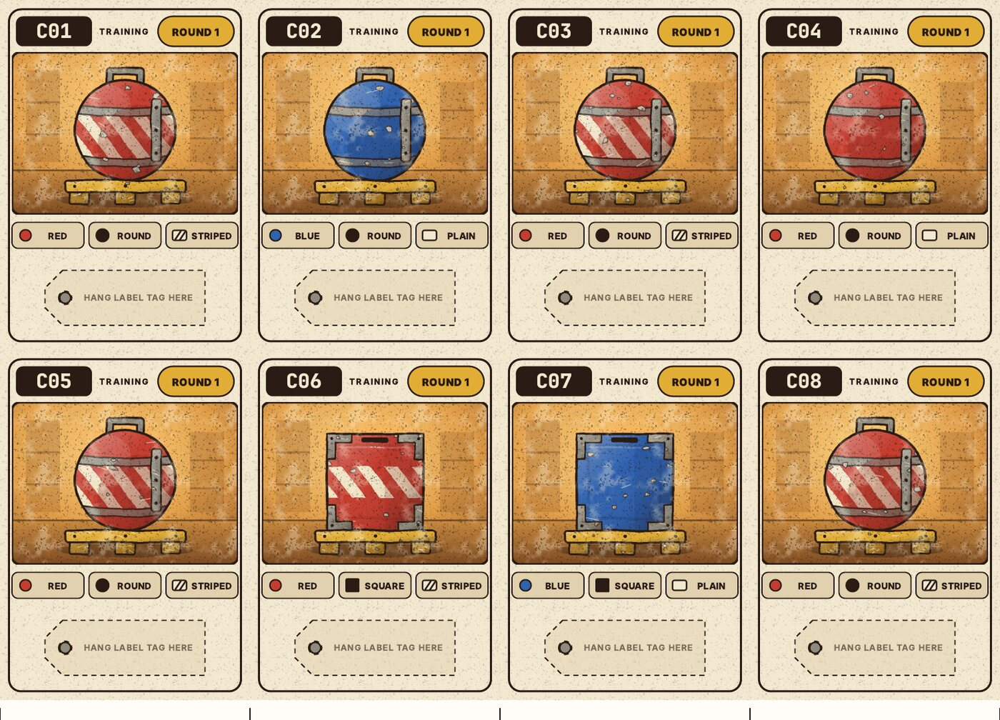
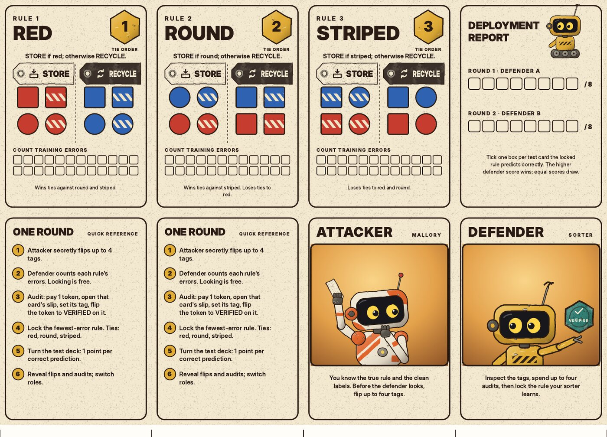
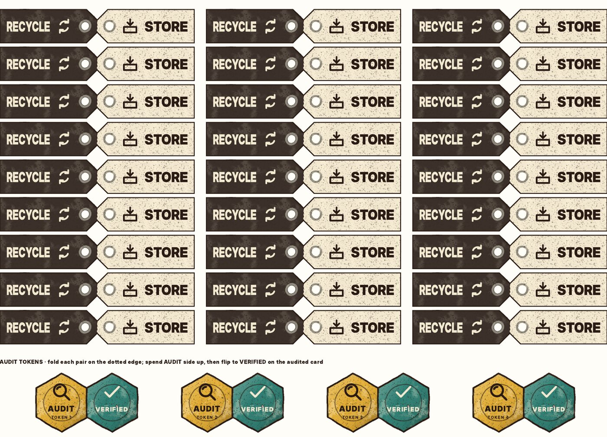
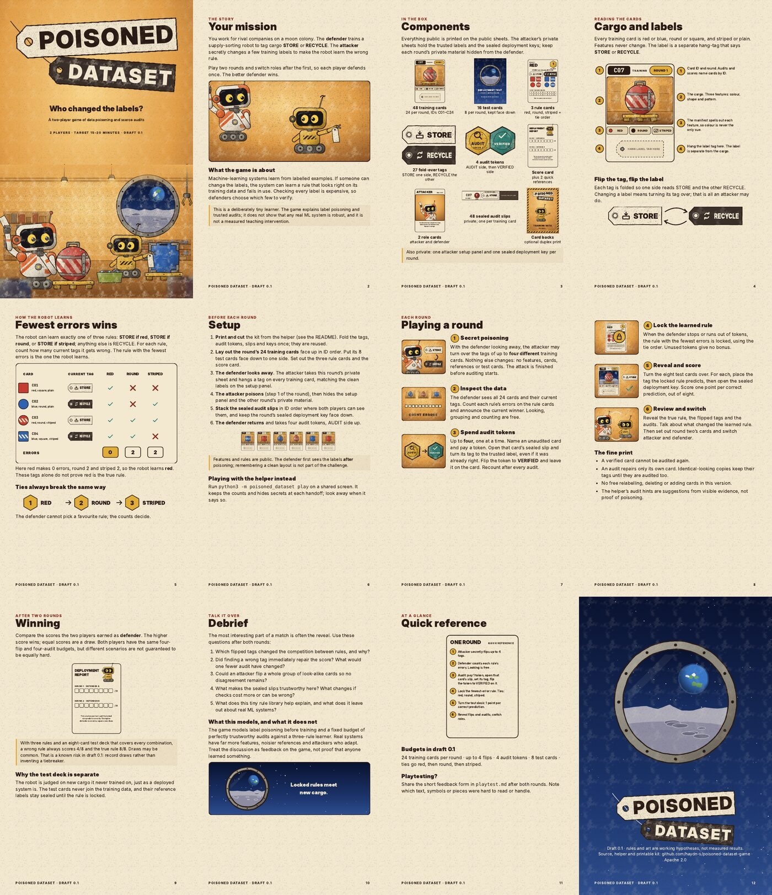
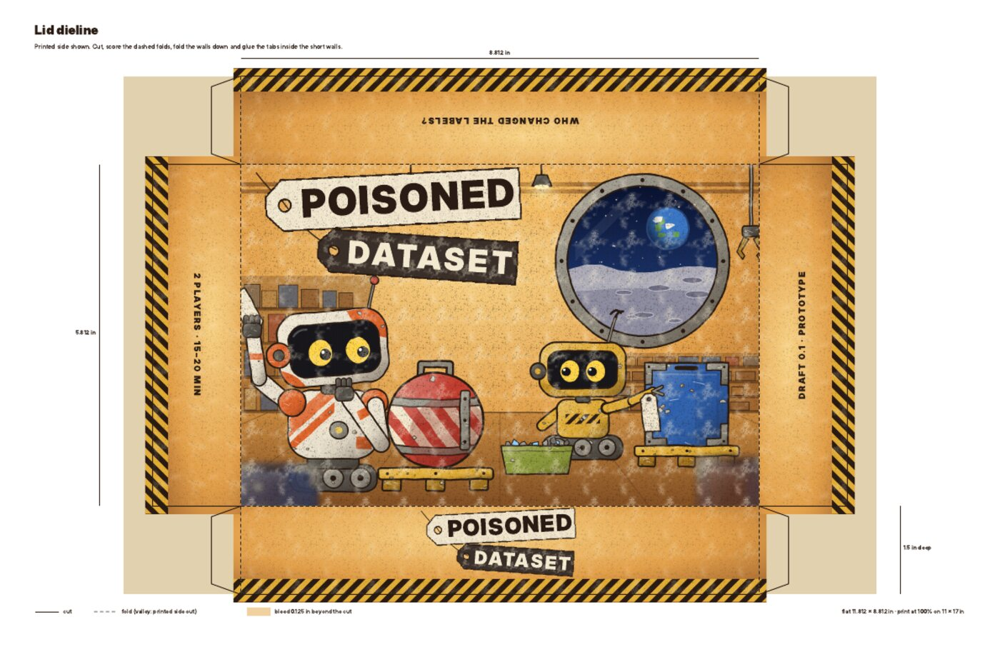
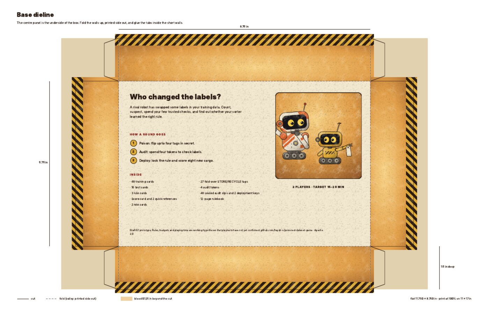

# Poisoned Dataset art direction and art review

Draft 0.1 · October 20, 2026

This document records a review of the art committed before this pass, the direction taken from the two key-art exhibits, and the visual system now used for every card, the rulebook, and the box. All of it is generated by `python3 -m poisoned_dataset components`; see the README for the file list and print settings.

## Review of the committed art

No image files have been committed: none in the current tree, in Git history on either branch, or in [haydn-s/poisoned-dataset-game#1](https://github.com/haydn-s/poisoned-dataset-game/pull/1). The visual material in the repository was the HTML kit that `components.py` generated. Rendering it at 100% showed a usable layout with no visual identity:

| Area | Finding before this pass | Change |
| --- | --- | --- |
| Identity | Flat circles and squares in red and blue on white; no setting, characters, or title treatment | Moon-colony cargo, two robot characters, a hang-tag logo, painted texture |
| Card size | 2.5 × 2.08 in with gaps between dashed borders, so every edge needed its own cut | Poker size (2.5 × 3.5 in), edge to edge with crop marks; one straight cut separates neighbours |
| Colour reliance | The text descriptions helped, but the pictures differed only by colour, outline, and three white bars | Each card carries a feature manifest: colour word and swatch, filled shape glyph, striped or plain swatch |
| Labels | 48 single-sided 2 × 0.3 in strips; flipping a label meant finding and swapping a different strip | 27 fold-over tags; turning a tag over is the label flip |
| Audit tokens | Text-only rectangles with no "spent" state; "mark the card verified" had no physical piece | Hex AUDIT tokens that flip to VERIFIED and stay on the audited card |
| Audit slips | Players wrote IDs by hand and folded once; a single fold can show the label through the paper | Printed IDs and a three-panel Z-fold with a dense tint panel that hides the label from both sides |
| Test deck | Identical in look to training cards apart from the ID | Night-sky deployment art, TEST header, and its own back |
| Backs, rulebook, box | None | Optional backs per deck, a 12-page illustrated rulebook, lid and base dielines, and a packing plan |

## Previews

Rendered from seed 42 at 100% and reduced for the web. Private sheets are not shown because they reveal answers.

## Key art exhibits

Two exhibits were supplied in the conversation that started this pass. Neither image is in the repository yet. If they should be kept, add them under `docs/art/reference/`. The generator can put raster key art on the lid with `--cover-image`.

- **Exhibit A** sets the cast and the staging. A shell-white robot with orange panels, a black visor screen, yellow eyes, an ear disc, and an antenna holds a blank tag beside a red, round, hazard-striped pod. A small mustard tread-bot hangs a tag on a blue, square, plain crate. Earth hangs over the Moon in a round porthole. The scene already uses the game's grammar: features belong to the cargo, labels are separate tags.
- **Exhibit B** sets the rendering. It has inked contours with uneven weight, chipped paint showing bare metal, gouache grain, warm amber shop light against cool porthole blue, and cargo on yellow pallets.

The brief was to use exhibit A's robots in exhibit B's style. The robots keep A's silhouettes, visor faces, and palettes. B supplies the hand-inked wobble, paint chips, rust, grain, and lighting.

## Cast

| Character | Role in the art | Design notes |
| --- | --- | --- |
| Mallory | The rival robot; attacker role card, reference backs, box | Shell-white with orange hazard panels, wide rounded helmet, black visor, half-lidded yellow eyes looking sideways, orange ear disc, red-tipped antenna, hand on chin, blank tag held aloft. The name follows the security convention for an active attacker. |
| The sorter | The defender's learning robot; defender role card, training backs, score card | Mustard boxy head, black visor, round earnest eyes, claw-tipped antenna, treads, hazard plate, claw hand hanging tags |
| Trent | Never drawn; the trusted reference | The wax seal on audit slips. In security writing, Trent is the trusted third party. |

The names are suggestions in flavour text only; no rule depends on them.

## Visual grammar

The three features always use the same visual cues, on every card and in the rulebook:

| Feature | Value | Drawing |
| --- | --- | --- |
| Colour | red / blue | Painted body colour `#c63d2f` / `#2f62b0`; manifest chip says RED or BLUE |
| Shape | round / square | Strapped pod with handle and latch / framed crate with corner caps, both on a yellow pallet |
| Pattern | striped / plain | A horizontal band of cream diagonal hazard stripes across the middle / no band |

Labels are never drawn on cargo. **STORE** tags are light cream with a box-into-tray icon. **RECYCLE** tags are dark slate with a chasing-arrows icon. The two differ in tone, icon, and word, so neither colour nor reading alone is required. Tag colours avoid the red and blue used for features.

Round 1 pieces use a mustard round chip, and round 2 pieces use teal with light lettering. Training art is lit by the amber shop. Test-deck art shows the lunar surface at night, so deployment cards cannot be mistaken for training data.

## Palette and type

| Token | Hex | Use |
| --- | --- | --- |
| Ink | `#2a1c14` | All outlines and body text |
| Paper | `#f3e8d0` | Card stock, STORE tags, rulebook pages |
| Shop amber | `#e7a443` → `#94592a` | Training scenes, box |
| Mustard | `#e2ad35` | Pallets, sorter, AUDIT tokens, round 1 |
| Teal | `#2f7f74` | VERIFIED tokens, round 2 |
| Slate | `#3b302a` | RECYCLE tags |
| Night | `#091230` → `#2f4f8f` | Test deck, deployment key, porthole |
| Orange | `#e0632a` | Mallory's panels |

Headings use Inter Display Black and body text uses Inter. Card IDs use JetBrains Mono so that C01 and CO1 are never confused. Browsers substitute similar fonts if these are missing, and tag lettering is fitted to its box, so substitutes cannot overflow. Exported PDFs embed whatever fonts were used.

## How the art is made

The art is procedural SVG in `poisoned_dataset/art.py`. It has no image files and no dependencies.

- **Seeded wear.** Paint chips, rust, scratches, stars, and craters come from the project's seeded random streams, so every kit reproduces byte for byte and each card's scuffs are unique to its ID.
- **Ink wobble.** A displacement filter makes outlines look hand-inked. Chromium rasterises filtered groups at 300 ppi when printing, so the wobble prints cleanly. Text is kept outside filters and stays vector.
- **Gouache grain.** A single 192-pixel seamless grain tile is generated in pure Python, then reused with `<use>`, so a PDF stores it once. Per-element noise filters made the public sheet 80 MB; the shared tile brought it to about 9 MB.
- **No SVG patterns.** Hazard stripes and the slip tint are drawn as vector hatching because Chromium re-rasterises every pattern instance when printing. That change cut the private sheet from 19 MB to under 2 MB.

## Production notes

- Cards are poker size. Home kits print edge to edge on Letter with paper-coloured edges that hide small cutting errors. A vendor export would need 0.125 in bleed per card; the card art already extends to the trim, so this needs an export step, not a redesign.
- The box is a telescoping two-piece box: the base is 8.75 × 5.75 × 1.5 in and the lid is 0.0625 in larger. The half-letter rulebook lies on top of three card wells and a front strip for tags, tokens, and the two private-slip envelopes. The dielines are for a cardstock mockup; confirm a supplier template before ordering.
- A professionally printed copy cannot regenerate seeded decks. One option to evaluate: print fixed training decks and keep only the private references seed-specific. The true rule is drawn independently of the training cards, so one fixed deck can serve all three secret rules. This would change setup and must be decided and tested before any production order.

## Checks before the art is frozen

- Print a kit and fold the tags, tokens, slips, and keys. Confirm that the Z-fold hides labels against a lamp and that tags stay on their pegs during play.
- Test the cards with a colour-vision simulator and in greyscale. The manifest should carry every feature.
- Time a setup with the new components and record it in the playtest record.
- Recheck the rulebook against `docs/prototype-rules.md` whenever the rules change; the copy is maintained in `rulebook.py`.
