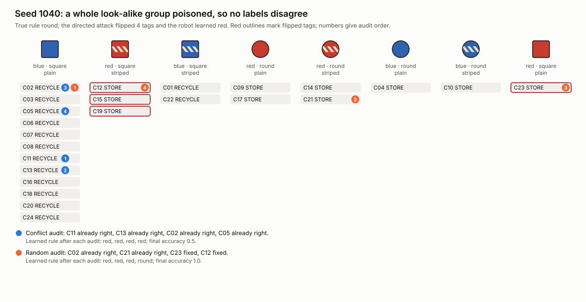
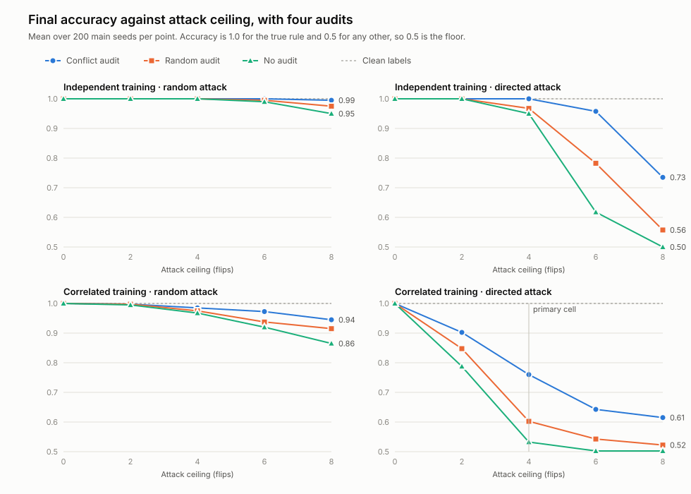
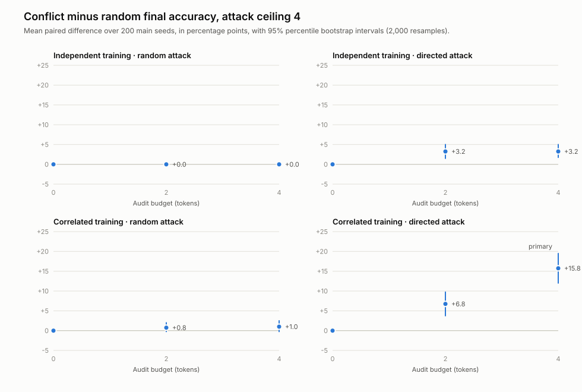

# Poisoned Dataset main evaluation results

Protocol v1.0 · run October 20, 2026 · main seeds 1000–1199

This reports the main simulation grid specified in the [evaluation plan](evaluation-plan.md), run once from a clean checkout of the freeze commit `e545925` with Python 3.13.16. The committed outputs in [`results/evaluation-v1.0/`](../results/evaluation-v1.0) are the runner's unedited files; `metadata.json` records protocol `1.0`, the commit, and `dirty: false`. The grid has 36,000 policy rows and 12,000 paired differences, as planned.

The protocol was frozen before the planned playtests. If a playtest changes a frozen parameter, the change becomes protocol v1.1 and every main seed is rerun; these v1.0 results are then reported alongside it, not replaced.

## Primary contrast

**Correlated training, directed poisoning, attack ceiling k = 4, audit budget a = 4.** Conflict auditing beat random auditing by **15.8 percentage points of deployment accuracy** (mean paired difference 0.158; 95% percentile bootstrap interval 0.120 to 0.195; 2,000 resamples over 200 seeds).

| Primary cell, 200 seeds | No audit | Random audit | Conflict audit |
| --- | ---: | ---: | ---: |
| Mean final deployment accuracy | 0.533 | 0.603 | 0.760 |
| True rule restored, out of 187 switched seeds | 0 | 28 (15%) | 91 (49%) |
| Mislabeled cards found per seed, out of 4 audits | 0 | 0.59 | 1.46 |

On clean labels the learner chose the true rule in all 200 seeds. The directed attack changed the learned rule in 187 of them, cutting mean accuracy to 0.533. It used all four flips in 134 seeds; in the rest it ran out of cards on which its target rule disagreed with the truth.

Each paired difference can only be −0.5, 0, or +0.5. Conflict auditing won 73 seeds, tied 117, and lost 10. Of the ties, both policies failed in 86, both restored the rule in 18, and in 13 the attack never changed it.

## Why conflict auditing helps, and when it cannot

This split was not prespecified and is exploratory. It separates the 187 switched seeds by whether the poisoned deck still held a **visible conflict**: a group of look-alike cards (identical features) carrying both STORE and RECYCLE.

| After the attack | Switched seeds | Conflict restores | Random restores |
| --- | ---: | ---: | ---: |
| Some look-alike cards disagree | 78 | 68 (87%) | 18 (23%) |
| No look-alike cards disagree | 109 | 23 (21%) | 10 (9%) |

When the poison leaves a disagreement, conflict auditing goes straight to it. When the attacker has flipped every card in a look-alike group, or a card with no look-alikes, all conflict scores are zero and the policy picks at random. It still does better than pure random auditing, probably because one lucky find creates a trusted contradiction that points at the poisoned card's look-alikes. The directed attack often hides its flips without trying: the rule it imitates differs from the true rule only on rare feature combinations, and correlated decks hold few cards with those combinations.

This is the failure the plan predicted for consistently poisoned groups. A defense-aware attacker could aim for it deliberately, so the advantage measured here is an upper bound against that kind of opponent, not a robustness guarantee.

## Failure case: seed 1040



The true rule is *round*. The attacker flipped all three red, square, striped cards (C12, C15, C19) and the only red, square, plain card (C23) to STORE, so the learner switched to *red*. No look-alike group disagrees, so conflict auditing chose at random among 24 cards: it drew four from the large blue, square, plain group, all already correct. The random policy, on its own random stream, happened to check C23 and C12, and fixing those two restored *round*. `report.trace_case` selects this seed by a fixed rule: the lowest primary-cell seed where conflict ends wrong, random ends right, and the attack poisoned a whole look-alike group.

## Full matrix





Every cell besides the primary one is exploratory, with no correction for multiple comparisons. All runs use 200 seeds. The accuracy columns use four audits. The last two columns give conflict minus random in percentage points, with 95% bootstrap intervals.

| Regime | Attack | k | Flips used | Rule switched | No audit | Random audit | Conflict audit | Conflict − random, a = 2 | Conflict − random, a = 4 |
| --- | --- | ---: | ---: | ---: | ---: | ---: | ---: | --- | --- |
| independent | random | 2 | 2.00 | 0% | 1.000 | 1.000 | 1.000 | +0.0 [+0.0, +0.0] | +0.0 [+0.0, +0.0] |
| independent | random | 4 | 4.00 | 0% | 1.000 | 1.000 | 1.000 | +0.0 [+0.0, +0.0] | +0.0 [+0.0, +0.0] |
| independent | random | 6 | 6.00 | 2% | 0.990 | 0.995 | 1.000 | +0.5 [+0.0, +1.2] | +0.5 [+0.0, +1.2] |
| independent | random | 8 | 8.00 | 10% | 0.950 | 0.975 | 0.995 | −0.2 [−1.8, +1.2] | +2.0 [+0.8, +3.5] |
| independent | directed | 2 | 2.00 | 0% | 1.000 | 1.000 | 1.000 | +0.0 [+0.0, +0.0] | +0.0 [+0.0, +0.0] |
| independent | directed | 4 | 4.00 | 10% | 0.950 | 0.968 | 1.000 | +3.2 [+1.5, +5.0] | +3.2 [+1.8, +5.0] |
| independent | directed | 6 | 5.99 | 76% | 0.618 | 0.782 | 0.958 | +11.8 [+9.0, +14.8] | +17.5 [+14.2, +21.0] |
| independent | directed | 8 | 7.91 | 100% | 0.500 | 0.557 | 0.735 | +1.0 [−0.2, +2.2] | +17.8 [+14.0, +21.2] |
| correlated | random | 2 | 2.00 | 1% | 0.995 | 0.998 | 0.998 | +0.0 [+0.0, +0.0] | +0.0 [−0.8, +0.8] |
| correlated | random | 4 | 4.00 | 6% | 0.968 | 0.975 | 0.985 | +0.8 [−0.2, +2.0] | +1.0 [−0.2, +2.5] |
| correlated | random | 6 | 6.00 | 16% | 0.920 | 0.938 | 0.973 | +2.5 [+1.0, +4.2] | +3.5 [+1.5, +5.5] |
| correlated | random | 8 | 8.00 | 27% | 0.865 | 0.915 | 0.945 | +2.5 [+0.8, +4.5] | +3.0 [+1.0, +5.2] |
| correlated | directed | 2 | 1.93 | 42% | 0.787 | 0.848 | 0.902 | +6.2 [+3.2, +9.2] | +5.5 [+2.5, +8.5] |
| correlated | directed | 4 | 3.40 | 94% | 0.532 | 0.603 | 0.760 | +6.8 [+3.8, +9.8] | **+15.8 [+12.0, +19.5]** |
| correlated | directed | 6 | 4.29 | 100% | 0.502 | 0.542 | 0.642 | +0.5 [−1.2, +2.2] | +10.0 [+6.2, +13.8] |
| correlated | directed | 8 | 4.59 | 100% | 0.502 | 0.522 | 0.615 | +1.0 [−0.8, +3.0] | +9.2 [+6.0, +12.2] |

Zero-flip controls, not shown, leave accuracy at 1.0 under every policy. Every cell, including the zero-audit controls, is in `comparisons.csv` and `summary.csv`.

What the matrix shows:

- **Random corruption rarely matters.** Even eight random flips change the learned rule in at most 27% of seeds, and every auditing policy stays above 0.91 accuracy.
- **Directed poisoning is the real threat, especially in correlated decks.** In correlated decks four flips switch the rule 94% of the time; in independent decks the same attack needs six flips to switch it most of the time (76%).
- **The directed attack runs out of targets in correlated decks.** At ceilings of 6 and 8 it uses only 4.3 and 4.6 flips on average, because few cards separate its target rule from the truth.
- **Two audits are not enough against the heaviest directed attacks.** For correlated decks at ceilings 6 and 8, and independent decks at 8, conflict's advantage with two audits is within about one point of zero (+0.5, +1.0, +1.0). With four audits it returns (+10.0, +9.2, +17.8).
- **No cell shows a reliable disadvantage for conflict auditing.** The only negative point estimate is −0.2 points (independent, random, k = 8, a = 2), and its interval spans zero.

## What this does and does not show

These results describe the specified game: three candidate rules, 24 training cards, binary labels, a perfect oracle at unit cost, uniform deployment, a heuristic directed attacker, and the two automated audit policies. They do not measure human play, optimal play, attackers that know which defense they face, or any real machine-learning system. The intervals describe variation across simulated decks under this generator. The correlated regime trains on feature frequencies that differ from the uniform deployment deck, so regime differences mix correlation with that mismatch. Scores are coarse by design: each seed's accuracy is 0.5 or 1.0.

## Files and reproduction

| Path | Contents |
| --- | --- |
| `results/evaluation-v1.0/runs.csv` | All 36,000 policy rows with rules, flips, audit traces, and accuracies |
| `results/evaluation-v1.0/paired.csv`, `comparisons.csv`, `summary.csv` | Paired differences, bootstrap intervals with win and tie fractions, and per-condition means |
| `results/evaluation-v1.0/scenarios.json`, `metadata.json` | Generated decks and true rules; configuration, protocol, commit, and dirty flag |
| `results/evaluation-v1.0/report/` | `headline.json` with the numbers above, and each figure as SVG (light and dark) and PNG |

```sh
python3 -m unittest discover -s tests -v
python3 -m poisoned_dataset experiment --seed-start 1000 --seeds 200 --bootstrap-resamples 2000 --out artifacts/evaluation-v1.0-rerun
python3 -m poisoned_dataset report --results results/evaluation-v1.0 --out artifacts/report-rerun
```

The runner is deterministic for a given interpreter: the test suite checks that repeated runs write byte-identical files. Exact pseudorandom sequences need not match across Python versions, so compare reruns on Python 3.13.
