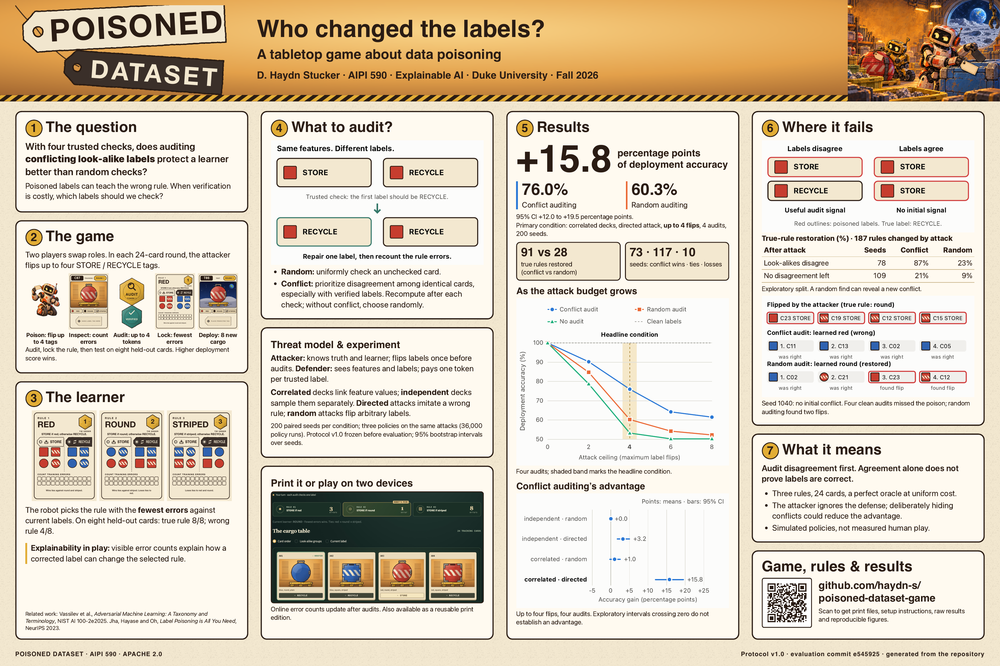

# Poster

A 36 × 24 in landscape poster for the course showcase, generated from the repository like the rest of the project. It goes to the printer on **November 13, 2026**.



| File | Contents |
| --- | --- |
| `poster.py` | The generator. Every number, table and figure is computed from [`results/evaluation-v1.0/`](../results/evaluation-v1.0), and the art and card images come from the game's own generators. |
| `poster.html` | The generated poster. Open it in a browser to check it; it loads the figures and images below. |
| `figures/` | Poster-sized figures: accuracy against attack ceiling in the primary condition, the paired difference in all four conditions, and the seed-1040 failure case. |
| `images/game-room.jpg` | A 2× capture of the online game room: the defender's audit view in round 1 on deck A, after a directed four-flip attack and one audit that found poison. It was made from a scratch room database, not a real playtest. |
| `images/qr-repo.svg` | A QR code for `https://github.com/haydn-s/poisoned-dataset-game` (version 4, error correction M, four-module quiet zone), made with [segno](https://pypi.org/project/segno/). It decodes from the rendered PDF. |
| `poster.pdf` | One 36 × 24 in page, rendered from `poster.html` in headless Chrome. |
| `poster-preview.png` | A 90 dpi preview of `poster.pdf`, for review only. Print from the PDF. |

It covers what the [roadmap](../docs/roadmap.md) asks of the poster: the research question, game loop, threat model, actual results, failure case, limitations, citations, and a legible link and QR code to the playable artifact and reproducibility materials. It also shows both ways to play, the fixed-deck print edition and the online game room, and the current match tiebreakers.

## Rebuild

From the repository root:

```sh
python3 presentation/poster.py
python3 tools/render_print.py presentation
```

The first command rewrites `poster.html` and `figures/`; the second prints `poster.pdf`. The page size comes from the file, so print it with no margins or scaling. For a printer that needs another size, pass `--width` and `--height` in inches to `poster.py`; the layout is tuned for 36 × 24, so check other sizes for overflow before sending them. Column 4 has the least spare room, under a tenth of an inch.

`tests/test_poster.py` fails if `poster.html` or `figures/` differ from what `poster.py` generates, or if the poster references a missing file, so rebuild and commit them together.

## Fonts

The stylesheet asks for Inter, Inter Display and JetBrains Mono. They are not installed on the machine that rendered the current PDF, so Chrome substituted Helvetica Neue, Helvetica and Menlo, and the layout was checked with those. The PDF embeds the fonts it used, so the printer sees exactly the preview. If you install Inter before rendering again, the text reflows; check column 4 for overflow.

## Size

36 × 24 in (Arch D, landscape) is a stock size at most poster printers and fits a standard tri-fold or easel board. A smaller sheet would push body text below about 16 pt, which is hard to read from a few feet away. Keep this size unless the showcase limits board space.

## Before printing

- Confirm the printer's required size, bleed and file settings. The file has no bleed area: the amber header band runs to the trim, so ask whether the printer needs bleed added. The footer text sits 0.3 in inside the trim and the panels 0.55 in.
- Scan the QR code from a full-size test print before sending.
- Proofread a full-size section printed at 100% on Letter paper to check type sizes and figure legibility.
- Keep the submitted PDF and the printer's confirmation with the release materials.
