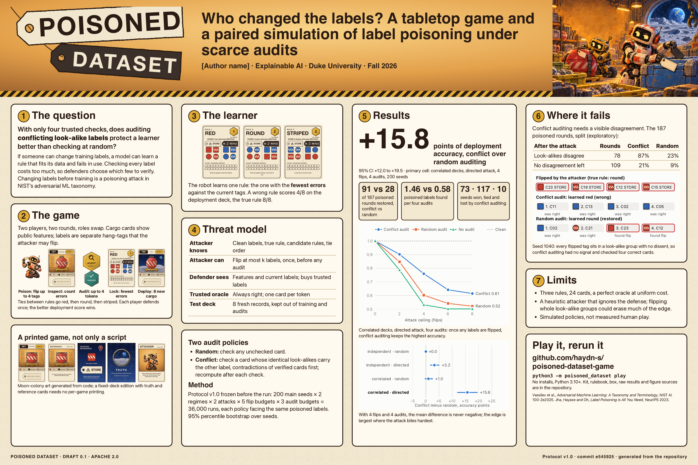

# Poster

A 36 × 24 in landscape poster for the course showcase, generated from the repository like the rest of the project.



| File | Contents |
| --- | --- |
| `poster.py` | The generator. Every number, table and figure is computed from [`results/evaluation-v1.0/`](../results/evaluation-v1.0), and the art and card images come from the game's own generators. |
| `poster.html` | The generated poster. Open it in a browser to check it; it loads the three figures below. |
| `figures/` | Poster-sized figures: accuracy against attack ceiling in the primary condition, the paired difference in all four conditions, and the seed-1040 failure case. |
| `poster.pdf` | One 36 × 24 in page, rendered from `poster.html` in headless Chromium. |
| `poster-preview.png` | A screen-resolution preview, for review only. Print from the PDF. |

It covers what the [roadmap](../docs/roadmap.md) asks of the poster: the research question, game loop, threat model, actual results, failure case, limitations, citations, and a legible link to the playable artifact and reproducibility materials.

## Rebuild

From the repository root:

```sh
python3 presentation/poster.py
```

This rewrites `poster.html` and `figures/`. For a printer that needs another size, pass `--width` and `--height` in inches; the layout is tuned for 36 × 24, so check other sizes for overflow before sending them.

To make the PDF, open `poster.html` in Chrome or Chromium, print with **background graphics** on, margins **none** and scale **100%**, and save as PDF. The page size comes from the file. Fonts are Inter, Inter Display and JetBrains Mono; install them first or the browser will substitute others, and the text may then reflow.

`tests/test_poster.py` fails if `poster.html` or `figures/` differ from what `poster.py` generates, so rebuild and commit them together.

## Before printing

- Replace `AUTHOR` in `poster.py` with your name, rebuild, and render the PDF again.
- Confirm the printer's required size, bleed and file settings. The file has no bleed area: the amber header band runs to the trim, so ask whether the printer needs bleed added. The footer text sits 0.3 in inside the trim and the panels 0.55 in.
- A QR code is optional. The repository link is set large enough to read from a few feet away; if you add a code, generate it as SVG and put it beside the link in the last panel.
- Proofread a full-size section printed at 100% on Letter paper to check type sizes and figure legibility.
- Keep the submitted PDF and the printer's confirmation with the release materials.
