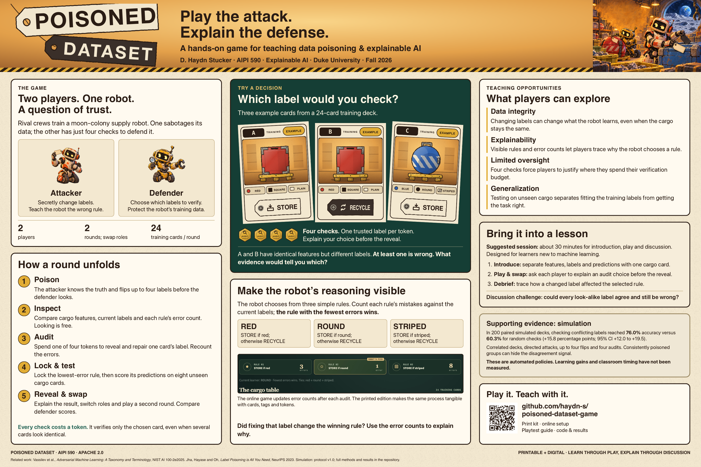

# Poster

A 36 × 24 in landscape poster presenting **Poisoned Dataset** as a playable teaching tool for data poisoning and explainable AI.



The three-column design leads with the game and a decision for the reader to try:

- **The game:** attacker and defender roles, 24 training cards, and the five stages of a round.
- **Try a decision:** three large illustrated cargo cards with separate label tags, four audit tokens, and an invitation to explain which label to check. The hand is a conceptual example, not a complete deck or a recorded playtest.
- **Teaching opportunities:** data integrity, explainability, limited oversight, and generalization, followed by a suggested introduction, play, role swap, and debrief.

The proposed session is about 30 minutes including discussion, following the [playtest guide](../playtest.md). The poster describes intended teaching uses; it does not claim measured learning gains or validated classroom timing. The [observation sheet](../docs/playtest-record.md) provides prompts for formative feedback.

Simulation occupies a small supporting panel, with no result charts or oversized statistical headline. Its numbers still come from [`results/evaluation-v1.0/report/headline.json`](../results/evaluation-v1.0/report/headline.json): 76.0% versus 60.3% deployment accuracy and a +15.8 percentage-point paired difference (95% CI +12.0 to +19.5). These describe automated audit policies on 200 simulated decks in the primary condition: correlated features, directed attacks, an attack ceiling of four flips, and four audits. They are not human playtest or learning outcomes. Displayed accuracy rates use decimal half-up rounding; the contrast uses unrounded paired results. Full evaluation charts remain in [`results/evaluation-v1.0/report/`](../results/evaluation-v1.0/report/).

| File | Contents |
| --- | --- |
| `poster.py` | Generator for the poster layout, game illustrations, and supporting simulation text. |
| `poster.html` | Generated poster with inline vector game art; loads the two images below. |
| `images/game-room.jpg` | A staged online audit view, cropped by the layout to emphasize candidate-rule errors and the chosen rule. The source image is unchanged; it is not a human playtest record. |
| `images/qr-repo.svg` | Repository QR code, checked against the rendered PDF preview. |
| `poster.pdf` | One 36 × 24 in page, rendered from the HTML in headless Chrome. |
| `poster-preview.png` | A 90 dpi preview for review. Print from the PDF. |

The QR opens the repository, which contains the print kit, online setup instructions, playtest guide, code, and results. It does not open a hosted game.

## Rebuild

From the repository root:

```sh
python3 presentation/poster.py
python3 tools/render_print.py presentation
pdftoppm -f 1 -singlefile -r 90 -png presentation/poster.pdf presentation/poster-preview
```

The first command regenerates the HTML; the second prints the PDF; the third updates the preview using Poppler. The page size comes from the file, so print it with no margins or scaling. The generator accepts `--width` and `--height` in inches, but the design is tuned for 36 × 24; inspect other sizes for overflow before printing.

`tests/test_poster.py` checks that the HTML matches the generator, the supporting statistics match the frozen results, images exist, and reused SVG art has its definitions. Commit the generator, HTML, PDF, and preview together.

## Fonts and printing

**Send [`poster.pdf`](poster.pdf) to the print shop.** It follows the Blurred Lens delivery format: one full-size PDF 1.4 page on a 24 × 36 inch sheet. This poster is landscape (36 inches wide × 24 inches high); Blurred Lens was portrait. Print at **actual size / 100%**, with no fit-to-page scaling or added margins. The PNG is a review preview, not the print file.

Like the Blurred Lens PDF, this file is the exact finished size, with no added bleed or crop marks. The background and header reach the page edges. Paper, finish, mounting, and other order details are selected separately with the shop.

The stylesheet requests Inter and Inter Display. The rendering machine uses system fallbacks; all 87 PDF font resources are embedded or contain their own glyph drawings. Main text remains vector, and the PDF contains its images without requiring the HTML or image folder. If the installed fonts change, check the layout again.

The print check verified one unencrypted 2592 × 1728 point page, included fonts, retained text, a clean PDF render, and a readable repository QR code. A physical proof can additionally confirm the shop's color and paper rendering.
